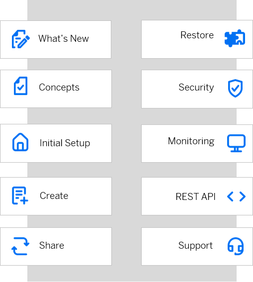

<!-- loioad63368e8e6f44a1b3ac336e8d1c32b8 -->

# SAP Credential Store

### What's New

Stay informed about the newest features and updates of SAP Credential Store.

For more information, see [What's New for SAP Credential Store](what-s-new-for-sap-credential-store-6a37641.md).

### Concepts

Understand the concepts relevant for SAP Credential Store.

For more information, see [Concepts](concepts/concepts-716314a.md).

### Initial Setup

Explore the required steps to get started with SAP Credential Store.

For more information, see [Initial Setup](initial-setup-d5f1ce7.md).

### Create Credentials

Learn how to create your first credential \(password, key, or keyring\).

For more information, see [Create a Service Instance](admin-and-ops/create-a-service-instance-dc5f087.md).

### Share Service Instances

Learn how to share SAP Credential Store service instances with a space or a subaccount in the same or another region.

For more information, see [Share, Unshare, and Authorize a Service Instance](admin-and-ops/share-unshare-and-authorize-a-service-instance-bcd0a59.md).

### Restore from Backup

Learn how to restore accidentally deleted credentials or entire namespaces.

For more information, see [Restore Credentials from Backup](admin-and-ops/restore-credentials-from-backup-7d07886.md).

### Security

Use the security features of SAP Credential Store to support the security policies of your organization.

For more information, see [Security](security/security-3fe6362.md).

### Monitoring

Set up your service instance to start getting notifications about expiring credentials, bindings, and others.

For more information, see [Set up SAP Alert Notification Events](admin-and-ops/set-up-sap-alert-notification-events-5335e33.md).

### REST API

Get to know the APIs of SAP Credential Store delivered on the SAP Business Accelerator Hub.

For more information, see [SAP Credential Store APIs](https://api.sap.com/package/CredentialStore/rest).

### Support

Get support when you have questions or encounter issues while working with SAP Credential Store.

For more information, see [Get Support](get-support-c6ebd58.md).

